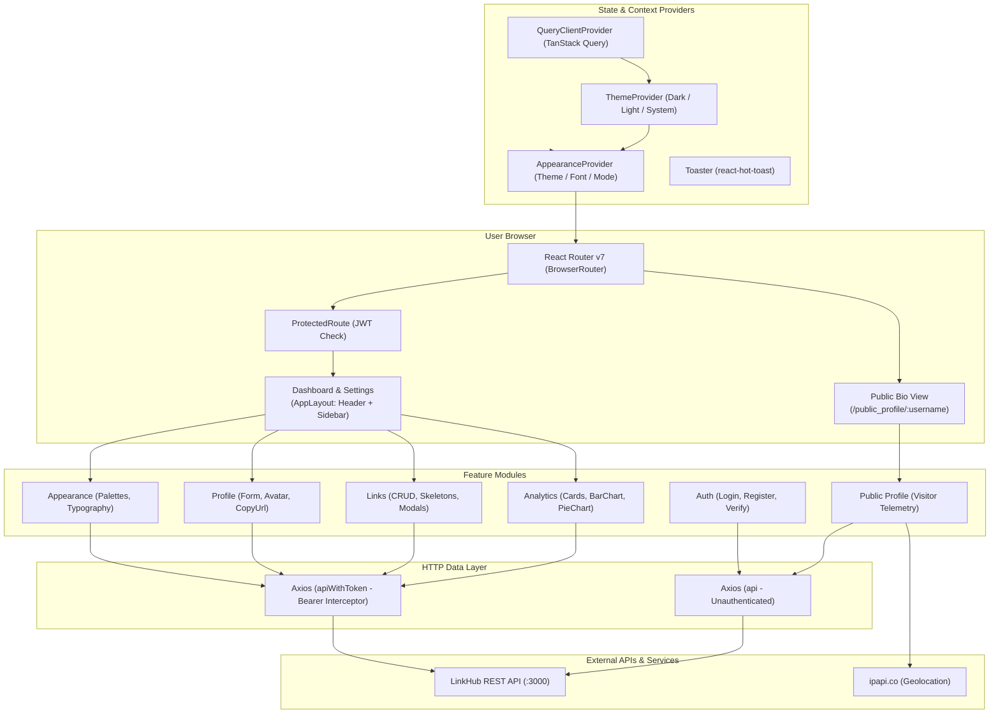
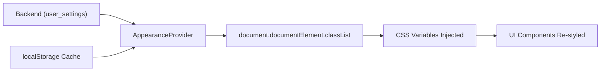

# LinkHub Client

> Modern, responsive, and customizable link-in-bio web application built with React 19, TypeScript, Vite, Tailwind CSS v4, Shadcn UI, and TanStack Query.

[](https://react.dev/)
[](https://www.typescriptlang.org/)
[](https://vite.dev/)
[](https://tailwindcss.com/)
[](https://tanstack.com/query)
[](https://recharts.org/)
[](#license)

---

## Table of Contents

- [Overview](#overview)
- [The Problem & The Solution](#the-problem--the-solution)
- [Core Features](#core-features)
- [System Architecture](#system-architecture)
- [Repository Structure](#repository-structure)
- [Pages & User Flows](#pages--user-flows)
  - [Public Bio Profile & Telemetry](#public-bio-profile--telemetry)
  - [Analytics Dashboard](#analytics-dashboard)
  - [Link Management](#link-management)
  - [Live Theme Customizer](#live-theme-customizer)
  - [Profile & Avatar Management](#profile--avatar-management)
  - [Authentication & Verification](#authentication--verification)
- [Theming & CSS Variable Engine](#theming--css-variable-engine)
- [Tech Stack](#tech-stack)
- [Getting Started](#getting-started)
  - [Prerequisites](#prerequisites)
  - [Installation](#installation)
  - [Configuration](#configuration)
  - [Available Scripts](#available-scripts)
- [Problems Solved & Engineering Highlights](#problems-solved--engineering-highlights)
- [Limitations & Roadmap](#limitations--roadmap)
- [License](#license)

---

## Overview

**LinkHub Client** is the official web application frontend for the LinkHub platform. It delivers a fast, responsive user interface designed for two distinct audiences:

1. **Content Creators & Businesses:** An administrative dashboard for curating personal link trees, managing profile avatars, customizing design themes, and analyzing visitor interactions with interactive charts.
2. **Public Profile Visitors:** Fast, lightweight landing pages (`/public_profile/:username`) that display active links with client-side telemetry (capturing device type, browser, and country upon click).

Built on React 19, Vite 8, and Tailwind CSS v4,  Client leverages TanStack Query for cache invalidation and Recharts for responsive data visualization.

---

## The Problem & The Solution

### The Problem
- **Slow Bio-Link Page Load Times:** Traditional bio-link services often deliver bloated client bundles containing unnecessary scripts and uncompressed assets, resulting in poor mobile conversion and high bounce rates.
- **Disconnected Theming:** Users typically cannot customize their bio profiles without encountering rigid design templates that fail to reflect their personal or corporate visual branding.
- **Lack of Actionable Analytics:** Many creators lack granular insights into which links generate engagement, what devices visitors use, or where audience traffic originates.
- **Inconvenient Workflow:** Managing profile details, link order, social icons, and branding across separate, disjointed interfaces frustrates creators.

### The Solution
- **Instant Client Performance:** Vite-powered modern ES module builds with Tailwind CSS v4 utility classes ensure rapid First Contentful Paint (FCP) on mobile networks.
- **Dynamic CSS Variable Theming:** An integrated `AppearanceProvider` dynamically injects CSS custom properties and utility classes across 7 color palettes, 3 typography families, 2 button border radii, and light/dark modes with instant live preview.
- **Real-Time Click Telemetry:** Client-side user-agent sniffing combined with IP geolocation silently logs visitor device type, browser, and geographic origin on every link tap before redirecting.
- **Unified Creator Hub:** All operational functions—links CRUD, avatar upload with instant preview, link sharing, and multi-interval charts—are consolidated in a clean dashboard layout.

---

## Core Features

- **Responsive Public Bio Pages (`/public_profile/:username`):**
  - Instant loading with responsive layout optimized for mobile screens.
  - Active curated links rendered with custom dynamic icons (`website`, `github`, `x`, `linkedin`, `instagram`, `email`, etc.).
  - Automatic visitor telemetry capturing device (`mobile`, `tablet`, `desktop`), browser (`Chrome`, `Safari`, `Firefox`, `Edge`, `Opera`), and country via IP geolocation.

- **Interactive Analytics Dashboard (`/dashboard`):**
  - **Overview Metric Cards:** Real-time counters for Total Links, Total Clicks, and Active Links.
  - **Link Performance Chart:** Recharts BarChart visualizing top-performing links styled with the active brand theme color (`var(--color-primary-500)`).
  - **Audience Distribution Chart:** Recharts PieChart breakdown by Country, Device Type, or Browser.
  - **Timeframe Filtering:** Switch between `today`, `week`, `month`, and `all-time` with URL search parameter persistence.

- **Curated Link Management (`/dashboard/links`):**
  - Create, view, edit, and delete links.
  - Form validation with Zod and React Hook Form.
  - Protocol whitelist validation (`http:`, `https:`, `mailto:`, `tel:`).
  - Active status toggle allowing instant publishing or unpublishing of specific links.
  - Dedicated skeleton loading states for zero layout shift during data fetching.

- **Live Appearance Customizer (`/dashboard/appearance`):**
  - **Color Schemes (7):** Green (`#3db19c`), Red (`#ef4444`), Blue (`#6366f1`), Purple (`#a855f7`), Orange (`#f97316`), Cyan (`#06b6d4`), and Zinc/Black (`#52525b`).
  - **Typography (3):** Geist (`font-geist`), Manrope (`font-manrope`), and Plus Jakarta Sans (`font-jakarta`).
  - **Button Borders (2):** Soft borders (`border-soft`) vs. sharp geometry (`border-sharp`).
  - **Display Modes (3):** Light, Dark, or System preference.
  - **Localization Support:** Interface language toggles between English (`en`) and Arabic (`ar`).
  - Persistent state saved to both `localStorage` and backend `user_settings`.

- **Profile & Avatar Management (`/dashboard/profile`):**
  - In-browser avatar file selection and instant preview.
  - Direct multipart upload to backend & Supabase Storage pipeline.
  - One-click public link clipboard copy (`CopyUrl` component) with toast notifications.

- **Authentication & Security (`/login`, `/register`, `/verify_email`):**
  - Form validation with Zod schemas.
  - Route guard (`ProtectedRoute`) validating Bearer JWT in `localStorage`.
  - Axios request interceptor injecting `Authorization: Bearer <token>` on all private API calls.
  - Email verification confirmation interface.

---

## System Architecture



---

## Repository Structure

```
LinkHub/
├── public/                         # Static assets
├── src/
│   ├── assets/                     # Bundled images and vectors
│   ├── components/                 # Shared UI components & Radix wrappers
│   │   └── ui/                     # Button, Card, Dialog, Input, Sheet, ToggleGroup, etc.
│   ├── features/                   # Domain-driven feature modules
│   │   ├── appearance/             # Live theming forms, rows, and mutation hooks
│   │   ├── auth/                   # Login, Signup, Forgot Password, & Verification
│   │   ├── dashboard/              # Overview cards, Recharts Bar/Pie charts, and filters
│   │   ├── link/                   # Link cards, add/edit forms, and action menus
│   │   ├── profile/                # Profile editing, avatar upload, and CopyUrl button
│   │   └── publicProfile/          # Public bio page, link items, & visitor telemetry
│   ├── hooks/                      # Global custom hooks (useCountry, etc.)
│   ├── layouts/                    # Application layouts (AppLayout, Header, Sidebar)
│   ├── lib/                        # Axios instance, user-agent sniffers, utils
│   │   ├── axios.ts                # Base API and Bearer authenticated clients
│   │   ├── getBrowser.ts           # Client browser detector
│   │   ├── getDeviceType.ts        # Client device type detector (mobile/tablet/desktop)
│   │   └── utils.ts                # Class merging utility (clsx + tailwind-merge)
│   ├── pages/                      # Top-level page routes
│   │   ├── Appearance.tsx          # /dashboard/appearance
│   │   ├── DashboardPage.tsx       # /dashboard
│   │   ├── ForgotPasswordPage.tsx  # /forgot_password
│   │   ├── LinkPage.tsx            # /dashboard/links
│   │   ├── LoginPage.tsx           # /login
│   │   ├── ProfilePage.tsx         # /dashboard/profile
│   │   ├── PublicProfilePage.tsx   # /public_profile/:username
│   │   ├── RegisterPage.tsx        # /register
│   │   └── VerifyEmailPage.tsx     # /verify_email
│   ├── providers/                  # React Context providers (AppearanceProvider, Theme)
│   ├── services/                   # API service interfaces (apiAuth, apiLink, apiClick)
│   ├── types/                      # TypeScript definitions (DTOs, appearance tokens)
│   ├── App.tsx                     # Route hierarchy, query client, and toast provider
│   ├── index.css                   # Tailwind v4 import, custom variables, and theme classes
│   └── main.tsx                    # React DOM root entry point
├── components.json                 # Shadcn UI configuration
├── eslint.config.js                # ESLint configuration
├── index.html                      # HTML document shell
├── package.json                    # Project scripts and dependencies
├── tailwind.config.js              # Tailwind fallback configuration
├── tsconfig.app.json               # TypeScript compiler config for frontend code
├── tsconfig.json                   # TypeScript project references
├── vite.config.ts                  # Vite build configuration & path aliases (@)
└── README.md                       # Documentation
```

---

## Pages & User Flows

### Public Bio Profile & Telemetry
- **Route:** `/public_profile/:username`
- **Execution Flow:**
  1. Visitors access the creator's URL (e.g. `https://LinkHub.app/public_profile/alex`).
  2. The page queries `GET /api/users/public-profile/:username`.
  3. In parallel, `useCountry` queries `https://ipapi.co/json/` while `getDeviceType` and `getBrowser` parse `navigator.userAgent`.
  4. When a visitor clicks any link button, `recordClick` dispatches `POST /api/clicks/:linkId` with payload `{ country, device_type, browser }`.
  5. The visitor navigates to the target destination without disruption.

### Analytics Dashboard
- **Route:** `/dashboard`
- **Execution Flow:**
  1. Fetches click statistics from `GET /api/clicks/stats` and links from `GET /api/links`.
  2. Aggregates metrics into **Total Links**, **Total Clicks**, and **Active Links**.
  3. Displays a **Links Performance BarChart** highlighting click volume per link title.
  4. Displays a **GroupBy PieChart** analyzing audience distribution across selectable dimensions (`country`, `device_type`, `browser`) and timeframes (`today`, `week`, `month`, `all`).

### Link Management
- **Route:** `/dashboard/links`
- **Execution Flow:**
  1. Displays the user's links sorted by position.
  2. Creators can toggle link visibility (`is_active`), edit metadata, reorder, or delete links.
  3. Adding a link prompts a modal with instant validation for URL protocol, title character limits, and icon selection.
  4. TanStack Query automatically invalidates the query cache upon mutation to reflect updates instantly.

### Live Theme Customizer
- **Route:** `/dashboard/appearance`
- **Execution Flow:**
  1. Loads user appearance configuration via `useSetting()` and updates form state.
  2. Users toggle primary color swatches, button border roundness, font families, or color modes.
  3. Changes immediately apply to `document.documentElement.classList`, rendering a real-time live preview.
  4. Submitting the form persists selections to `PATCH /api/settings` and caches them in `localStorage`.

---

## Theming & CSS Variable Engine

LinkHub features a custom theming pipeline implemented in `src/providers/AppearanceProvider.tsx` and `src/index.css`:



### Supported Token Options

| Category | Available Classes / Values | Description |
|---|---|---|
| **Color Palettes** | `theme-green`, `theme-blue`, `theme-red`, `theme-purple`, `theme-orange`, `theme-cyan`, `theme-black` | Injects 50–900 color scales and changes primary buttons, active sidebar tabs, and charts |
| **Typography** | `font-geist`, `font-manrope`, `font-jakarta` | Injects self-hosted `@fontsource` font families |
| **Border Radii** | `border-soft`, `border-sharp` | Controls button and card corner roundness |
| **Color Mode** | `light`, `dark`, `system` | Switches between light and dark root variables |
| **Languages** | `en`, `ar` | Language preference toggle |

---

## Tech Stack

| Domain | Technology | Version | Purpose |
|---|---|---|---|
| **Runtime & Bundler** | [Vite](https://vite.dev/) | `^8.0.10` | High-speed frontend development server and production bundler |
| **Language** | [TypeScript](https://www.typescriptlang.org/) | `~6.0.2` | Static typing, interface definitions, and compile-time safety |
| **UI Framework** | [React](https://react.dev/) | `^19.2.5` | Component tree and DOM reconciliation |
| **Routing** | [React Router](https://reactrouter.com/) | `^7.14.2` | Client-side routing, route guards, and query param state |
| **Server State** | [TanStack React Query](https://tanstack.com/query) | `^5.100.10` | Remote data fetching, caching, and cache invalidation |
| **Styling** | [Tailwind CSS](https://tailwindcss.com/) | `^4.2.4` | Utility-first CSS styling via `@tailwindcss/vite` |
| **Component Kit** | [Shadcn UI](https://ui.shadcn.com/) / [Radix UI](https://www.radix-ui.com/) | Latest | Accessible, unstyled UI primitives (Dialog, Sheet, Button, Card) |
| **Form Handling** | [React Hook Form](https://react-hook-form.com/) | `^7.75.0` | Performant form state management |
| **Schema Validation**| [Zod](https://zod.dev/) | `^4.4.3` | Schema definition and input validation |
| **Data Visualization**| [Recharts](https://recharts.org/) | `^3.8.1` | Declarative, responsive SVG charting engine |
| **Icons** | [Lucide React](https://lucide.dev/) | `^1.14.0` | Lightweight SVG icons |
| **HTTP Client** | [Axios](https://axios-http.com/) | `^1.16.1` | Promise-based HTTP client with request interceptors |

---

## Getting Started

### Prerequisites
- **Node.js:** v20.x or higher
- **npm:** v10.x or higher
- **LinkHub Backend Server:** Ensure [LinkHub-server](https://github.com/Omiskn/LinkHub-server) is running on `http://localhost:3000` (or configure your API proxy).

### Installation

1. **Clone the repository:**
   ```bash
   git clone https://github.com/Omiskn/LinkHub.git
   cd LinkHub
   ```

2. **Install dependencies:**
   ```bash
   npm install
   ```

### Configuration

The frontend API endpoint is defined in [`src/lib/axios.ts`](file:///C:/Users/OMISK/LinkHub/src/lib/axios.ts). By default, it targets:
```ts
baseURL: "http://localhost:3000/api"
```

To configure a custom backend URL, update the `baseURL` in `src/lib/axios.ts` or configure an environment variable with `import.meta.env.VITE_API_URL`.

### Available Scripts

In the project directory, you can run:

| Command | Description |
|---|---|
| `npm run dev` | Starts the Vite development server with Hot Module Replacement (HMR). |
| `npm run build` | Runs TypeScript compilation (`tsc -b`) and generates production bundles into `dist/`. |
| `npm run lint` | Lints source files using ESLint. |
| `npm run preview` | Locally serves the production build from `dist/` for verification. |

---

## Problems Solved & Engineering Highlights

- **Client-Side Visitor Telemetry Without Redirect Delay**
  - **Problem:** Capturing accurate click metrics (device, browser, country) often requires synchronous server redirects that introduce noticeable latency for visitors tapping bio links.
  - **Solution:** Asynchronous telemetry logging directly from the client.
  - **Implementation:** When the bio page mounts, `useCountry` fetches geographic details in the background while `getDeviceType` and `getBrowser` perform instant synchronous user-agent regex parsing. When a visitor clicks a link, `recordClick` sends the telemetry payload to `/api/clicks/:linkId` while allowing navigation to proceed.
  - **Benefit:** Yields granular audience analytics without degrading the visitor experience.

- **Flicker-Free Theme Synchronization**
  - **Problem:** Dynamic themes saved on the backend often cause visible layout flashes or color popping when pages reload before API responses return.
  - **Solution:** Two-tier hydration using `localStorage` and React Context.
  - **Implementation:** `AppearanceProvider` initializes state synchronously from `localStorage` on first render, instantly applying class tokens (`theme-green`, `font-geist`, `dark`) to `document.documentElement`. When `useSetting()` loads the latest backend preferences, it cleanly reconciles any differences.
  - **Benefit:** Instant visual consistency across page transitions and reloads.

- **Theme-Integrated Chart Rendering**
  - **Problem:** Third-party charting libraries like Recharts frequently use hardcoded hex colors that clash with custom user-selected themes.
  - **Solution:** Dynamic CSS custom property extraction.
  - **Implementation:** BarChart bars in `LinksPerformanceChart` dynamically utilize `fill="var(--color-primary-500)"`, ensuring chart visuals automatically adapt when a user changes their primary color palette.
  - **Benefit:** Maintains design cohesion across all analytics views.

- **Scoped Authentication via Request Interceptor**
  - **Problem:** Manually attaching JWT tokens across dozens of API call sites is error-prone and leads to authorization failures.
  - **Solution:** Dual Axios instances (`api` for public calls, `apiWithToken` for protected endpoints).
  - **Implementation:** `apiWithToken` uses an Axios request interceptor that extracts the current token from `localStorage` and injects `Authorization: Bearer <token>`.
  - **Benefit:** Guarantees authenticated requests remain secure while preventing token leakage on public calls.

---

## Limitations & Roadmap

### Current Limitations
- **Backend URL Config:** The API base URL is currently declared in `src/lib/axios.ts` rather than reading from a `.env` file via `import.meta.env.VITE_API_URL`.
- **Drag-and-Drop Reordering:** Links are ordered by numerical position, but drag-and-drop reordering (e.g. `@dnd-kit`) is not yet implemented.
- **Social Login Buttons:** The login and registration pages render social login icons, but OAuth handshakes are pending backend integration.

### Roadmap
- [ ] Add `.env.example` and switch `axios.ts` to `import.meta.env.VITE_API_URL`.
- [ ] Implement drag-and-drop link reordering using `@dnd-kit/core`.
- [ ] Implement Google and GitHub OAuth authentication flows.
- [ ] Add dark mode theme preview swatches inside the Appearance customizer.
- [ ] Introduce unit and component test suites using Vitest and React Testing Library.

---

## License

This project is privately owned and maintained. License terms are specified by the repository maintainer.
